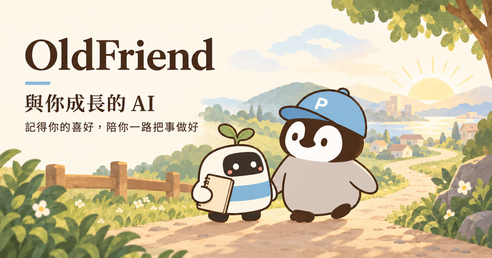

[繁體中文](README.zh-TW.md)

# OldFriend



**An AI that grows with you.** It remembers your preferences and helps you get things done over time.

OldFriend is a free, open-source memory and productivity package for the AI assistant you already use: Claude Code, Grok Bot, or another agent. It is a set of rules and skills that keeps a small plain-text memory on your assistant's computer, saves your corrections in your own words, and writes you a weekly letter. There is nothing to host and no account to make with us.

## Why I built it

I started working with AI agents in January 2026, and on 2026-01-31 I spent my first day on an open-source agent. I've always seen an AI agent as a long-term partner for getting things done, not a disposable tool you give orders to. I want mine to work with me from the first conversation on, across more and more of my life. OldFriend is the first piece of that practice I'm sharing.

## What v0.1 does

- **Remembers what matters.** Preferences go to `me/you.md`, live plans and dates to `me/now.md` (60 lines at most), raw notes to a monthly log. Each fact is written once, with a date.
- **Follows your corrections.** Say "Correction: …" or 「更正：…」. The fix is saved in your words and applied from the next reply on. Corrections outrank everything else in memory.
- **Writes a weekly letter.** What it noted, the corrections it follows, what's coming up, and up to three patterns it wants to check with you. A pattern becomes a lasting fact only after you say yes. On Grok Bot, setup offers it as a weekly routine (Sunday 20:00 by default, or a time you pick). On Claude Code, run `/oldfriend:oldfriend-letter` when you want it.
- **Keeps your files yours.** Plain Markdown you can open, edit or delete. Updates replace only the package files and back up your memory first.

The full loop is in [METHOD.md](METHOD.md).

## Where it's heading

v0.1 is the foundation. These are the four things I want an agent to grow into, and what this release covers today:

1. **Time to reflect**, distilling what it has learned about you. *In v0.1:* the weekly letter tidies memory and reviews with you what it has noticed.
2. **Learning from working with you**, and growing its own character from that. *In v0.1:* corrections and confirmed preferences change what it does from the next reply on. Character comes later.
3. **Getting things done**, including directing other agents. *In v0.1:* it keeps your live work, plans and dates in view. Directing other agents comes later.
4. **Creating on its own**: finding new things to do and bringing you proposals. *In v0.1:* it asks you to confirm preferences it infers, during work or in the weekly letter. Discovering and proposing new work on its own comes later.

## Install

### Claude Code (2.1.292 or newer)

In a terminal:

```
claude plugin install oldfriend --marketplace oldfriend-ai/oldfriend#v0.1.0
```

On older versions, run these inside Claude Code instead:

```
/plugin marketplace add oldfriend-ai/oldfriend#v0.1.0
/plugin install oldfriend@oldfriend
```

Before setup, check that `claude plugin list` shows `oldfriend@oldfriend` at version 0.1.0. If you had an earlier install, follow the checks in [INSTALL.md](INSTALL.md).

Then restart Claude Code in the folder where OldFriend should live, and run `/oldfriend:oldfriend-setup`.

### Grok Bot, Codex and other agents

Paste this into a chat with your assistant:

```
Read https://raw.githubusercontent.com/oldfriend-ai/oldfriend/v0.1.0/INSTALL.md and install OldFriend, tag v0.1.0. List the rules and files you will add, and wait for my OK before you change anything.
```

Grok Bot needs an eligible [Grok Bot plan](https://docs.x.ai/grok-bot/get-started). A one-click "Add to Grok Bot" template is coming later.

Step-by-step details for each host: [INSTALL.md](INSTALL.md).

## Where your memory lives

- **Claude Code**: `./oldfriend/` in the folder where you run Claude Code. With your OK, setup adds one line to that folder's `CLAUDE.md` so the assistant reads your memory each time.
- **Grok Bot**: `/workspace/oldfriend/` on your Grok Bot computer, which runs in the provider's cloud. Every Bot on your Grok account shares that computer, so **every Bot on your account can read your OldFriend memory.**
- **Other agents**: `oldfriend/` in the agent's working folder, plus one pointer line in its instruction file. Both are listed for your OK first.

The OldFriend project hosts nothing and receives none of your data. Your conversations are handled by your assistant's provider under its terms. Passwords, keys, tokens, recovery codes, ID numbers, card and bank account numbers stay out of memory.

Model training: on Grok Bot, training opt-out follows the privacy settings of the account your Grok Bot uses. Turn model training off there. The provider's [Grok Bot privacy page](https://docs.x.ai/grok-bot/approvals-security-and-privacy) has the current details. On Claude Code, model training is set in your Claude account's privacy settings.

## What it doesn't do

- **No automatic updates.** You start every update: the assistant backs up your memory, then walks you through it one confirmed step at a time.
- **No counseling or therapy.** It helps you remember and get things done. For counseling, please see a licensed professional.
- **General information only** on medical, legal and investment topics. Decisions belong with a doctor, a lawyer or a licensed financial adviser.
- **No sign-ins, purchases or payments.** Its skills read and write the `oldfriend/` folder and talk with you. Setup also adds one pointer to your memory: on Claude Code and other agents, with your OK, one line in the assistant's instruction file. On Grok Bot, one rule in Bot memory, plus a weekly letter routine if you want one.

## Good to know

- OldFriend runs on an AI and is not a person. It says so at setup and whenever you ask.
- It talks about work, plans and preferences, and talks about feelings only after you bring them up.
- The rules and skills guide your assistant, and it can still make mistakes. Check anything important.
- It is for adults 18 and older.
- If a conversation shows signs of crisis, it gives help lines right away (Taiwan 1925 / 1995, US 988). Details: [SAFETY.md](SAFETY.md).

## FAQ

**Does it cost anything?**
OldFriend is free under the MIT license. Your assistant's own plan still applies.

**Can I edit what it remembers?**
Yes. Open the files in `oldfriend/me/`, or tell it "Correction: …".

**Can two assistants share one memory?**
One computer keeps one OldFriend folder, and `oldfriend/VERSION` names the assistant that writes to it. Another assistant that finds the folder explains and waits. If you re-add the same Bot, a short handoff keeps your memory as it is.

**How do I update?**
On Claude Code or Grok Bot, ask your assistant to run `oldfriend-update`. It copies your memory to `me.bak-YYYY-MM-DD/` first, so a restore is one step away. Other agents: see Upgrades in [INSTALL.md](INSTALL.md).

## Docs

[METHOD.md](METHOD.md) · [INSTALL.md](INSTALL.md) · [SAFETY.md](SAFETY.md) · [CHANGELOG.md](CHANGELOG.md)

OldFriend is an independent open-source project, not affiliated with or endorsed by Anthropic, xAI/SpaceXSI or OpenAI. Claude is a trademark of Anthropic, Grok of xAI/SpaceXSI, and Codex of OpenAI.

---

By Penchan P · [MIT License](LICENSE) · Cover art: all rights reserved, see [assets/LICENSE](assets/LICENSE).
